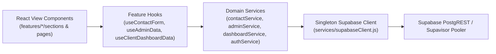

# Pixel & Brush — Architecture & Performance Guide

## 1. Folder Structure

The codebase follows a **feature-based modular architecture** with strict separation between UI presentation, state/hooks, domain services, and configuration:

```text
pixelandbrush/
├── public/
│   ├── index.html                  # Preconnected Google Fonts + preloaded WebP hero image
│   ├── me.webp                     # Compressed hero & about cutout (35 KB WebP, down from 388 KB PNG)
│   └── projects/                   # Compressed portfolio imagery (.webp)
├── supabase/
│   └── migrations/
│       └── 001_performance_indexes.sql  # PostgreSQL B-tree & partial indexes for all tables
├── src/
│   ├── app/
│   │   ├── AppRouter.jsx           # Route-level code splitting (React.lazy + Suspense + ErrorBoundary)
│   │   └── AuthArea.jsx            # Lazy-loaded auth/portal sub-tree (keeps Supabase off landing bundle)
│   ├── config/
│   │   ├── constants.js            # Brand constants, pagination limits, storage keys, allowed MIME types
│   │   └── env.js                  # Validated environment variable reader with safe fallbacks
│   ├── context/
│   │   └── AuthContext.jsx         # Memoized Supabase session provider + useAuth() hook
│   ├── services/
│   │   ├── supabaseClient.js       # Singleton Supabase client with PKCE session persistence
│   │   ├── errors.js               # AppError class, unwrap(), and structured error normalizers
│   │   ├── realtime.js             # Reusable multi-table Supabase Realtime channel helper
│   │   ├── authService.js          # signInWithPassword, signOut, getCurrentSession
│   │   ├── contactService.js       # Dynamic import() contact submission (loads Supabase on demand)
│   │   ├── adminService.js         # Paginated inquiries, bounded chat, project milestone updates
│   │   └── dashboardService.js     # Parallel dashboard fetch, file upload, approvals, realtime
│   ├── hooks/
│   │   ├── useDebounce.js          # useDebounce & useDebouncedCallback for input handlers
│   │   └── useReveal.js            # Shared IntersectionObserver hook for scroll reveal animations
│   ├── utils/
│   │   ├── fileValidation.js       # Client upload size, extension, and MIME-type verification
│   │   ├── storage.js              # Safe localStorage / sessionStorage wrappers
│   │   └── validators.js           # Pure email, login, and contact form validators
│   ├── components/
│   │   ├── common/                 # Reusable UI primitives (Button, Counter, SectionLabel, SplitHeading, PageSkeleton, ErrorBoundary)
│   │   ├── effects/                # Visual effects (HexMesh, Cursor, ScrollProgress, Loader, BackToTop, WhatsAppButton)
│   │   ├── layout/                 # Navbar, Ticker, Footer
│   │   └── ui/                     # Shadcn/TypeScript WebGL canvas components (black-hole.tsx)
│   ├── features/
│   │   ├── landing/
│   │   │   ├── HomePage.jsx        # Public agency landing page
│   │   │   ├── components/         # PhotoCutout, ServiceCard, PortfolioCard, PricingCard, TestimonialCard, FaqItem
│   │   │   ├── data/               # Static content modules (services, pricing, portfolio, testimonials, process, about, faq)
│   │   │   ├── hooks/              # useContactForm (validation, honeypot, 30s rate limit, submission state)
│   │   │   └── sections/           # Isolated section components (Hero, About, Services, Pricing, Portfolio, Testimonials, Process, Faq, Cta, Contact)
│   │   ├── auth/
│   │   │   ├── LoginPage.jsx       # Client & Admin portal login view
│   │   │   └── ProtectedRoute.jsx  # Role-aware route guard with PageSkeleton fallback
│   │   ├── dashboard/
│   │   │   ├── ClientDashboardPage.jsx      # Client portal UI
│   │   │   ├── stages.js                    # Pure stage progression calculator
│   │   │   └── hooks/useClientDashboardData.js # Parallel fetch, optimistic updates, memoized unread count
│   │   └── admin/
│   │       ├── AdminDashboardPage.jsx       # Admin portal UI with debounced inquiry search & pagination
│   │       └── hooks/useAdminData.js        # Admin state, pagination ("Load More"), and realtime updates
│   └── styles/
│       └── GlobalStyles.jsx        # Scoped keyframe animations & responsive layout rules
├── .env.example                    # Documented environment variable template
└── vercel.json                     # Vercel Edge CDN caching headers & SPA rewrite config
```

---

## 2. Layered Data Flow



1. **Zero Direct Database Calls in Components**: JSX components never import `supabase` directly. They consume state and action callbacks from feature hooks (`useContactForm`, `useAdminData`, `useClientDashboardData`).
2. **Centralized Error Handling**: Every Supabase response passes through `unwrap()` in `src/services/errors.js`, normalizing errors into `AppError` instances surfaced via non-blocking banners or toast notifications (no `window.alert()`).
3. **In-Place Realtime Appends**: Realtime listeners (`src/services/realtime.js`) append `payload.new` directly into state with deduplication instead of re-fetching entire tables on every `INSERT`.

---

## 3. Infrastructure, Load Balancing & Connection Pooling

- **CDN & Edge Caching (`vercel.json`)**:
  - Hashed JS/CSS bundles under `/static/*` are served from Vercel's global Edge CDN with `Cache-Control: public, max-age=31536000, immutable`.
  - `.webp` images and static media use `Cache-Control: public, max-age=604800, stale-while-revalidate=86400`.
- **Load Balancing**:
  - Static and SPA traffic is automatically load-balanced across Vercel's Anycast Edge Network.
  - API & WebSocket traffic is load-balanced by Supabase's managed API gateway across read/write replicas.
- **Database Connection Pooling**:
  - Browser clients connect through PostgREST over HTTP/2 and **Supavisor** (Supabase's built-in connection pooler on port `6543` for transaction mode / `5432` for session mode), while the frontend enforces a single shared `createClient()` instance (`src/services/supabaseClient.js`).
